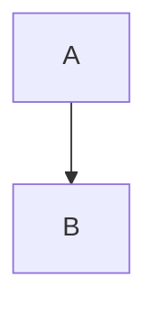

## Core claim

## Key mechanism

<!-- Then NUMBERED sections, one per major idea - "## 1. <the idea>".
     Not "How it works" / "Why it matters"; see examples/notes/example-concept-note.md.
     Specific mechanisms, exact figures, tables, short direct quotes. -->

## 1.

## Open questions

## My take

## Connections to existing notes
