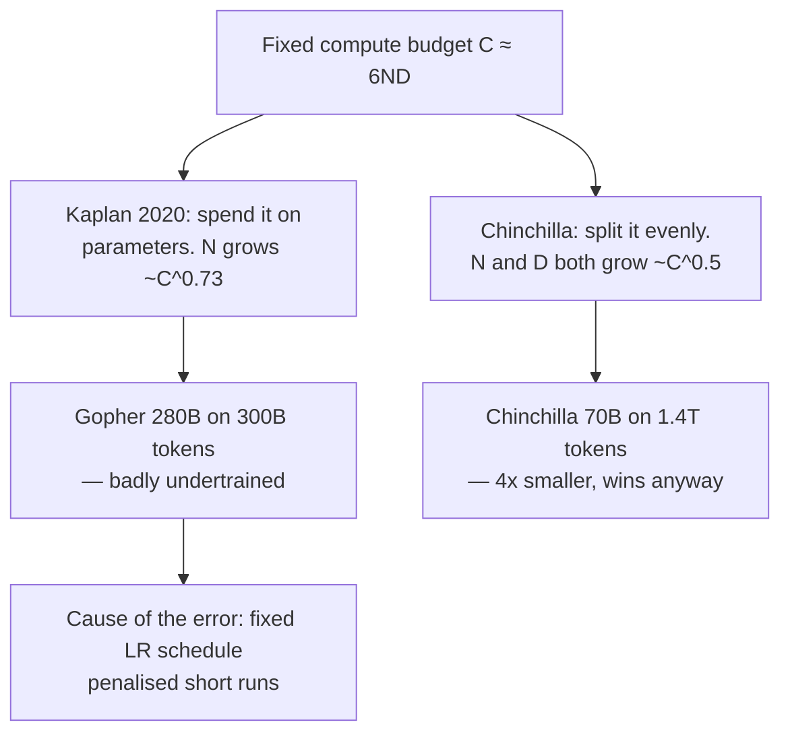

<!-- ILLUSTRATIVE EXAMPLE written for this repo, not extracted from a real vault.
     The content is accurate, but the point is the SHAPE: how dense a note has to be
     before it is worth more than the source. Delete this folder once you have notes
     of your own. -->

## Core claim

The compute-optimal ratio of model parameters to training tokens had been wrong for two years, and the error was large. Kaplan et al. (2020) concluded that given more compute you should spend most of it making the model bigger, which is why 2020–2022 produced a generation of very large, badly undertrained models. Hoffmann et al. show that parameters and tokens should scale **in roughly equal proportion** — and demonstrate it by training **Chinchilla (70B)** to beat **Gopher (280B)** on nearly every benchmark using the same compute budget. The load-bearing detail is *why* the earlier result was wrong rather than merely imprecise: Kaplan held the learning-rate schedule fixed across runs of different lengths, which systematically penalised the short runs that a token-heavy regime depends on. A methodology artifact, not a property of transformers.

## Key mechanism

## 1. The three estimation approaches, and why agreement matters

They estimate the optimal frontier three independent ways, which is what makes the result hard to dismiss:

1. **Fixed model sizes, varying tokens** — train each size over several budgets, read the minimum off each curve
2. **IsoFLOP profiles** — fix the budget, vary model size, find the loss-minimising size
3. **Parametric loss fit** — fit `L(N, D) = E + A/N^α + B/D^β` and solve analytically

All three land on exponents near 0.5 for both parameters and tokens. Independent methods converging is the actual evidence here; any one of them alone would be a curve fit.

## 2. The numbers worth remembering

| | Gopher | Chinchilla |
|---|---|---|
| Parameters | 280B | **70B** |
| Training tokens | 300B | **1.4T** |
| Compute | same | same |
| MMLU | 60.0% | **67.6%** |

The heuristic that came out of this: **~20 tokens per parameter**. Treat it as a rule of thumb from a specific setup rather than a constant of nature — it assumes a single pass over unique data and says nothing about inference cost.

## 3. The implication nobody acted on immediately

If a 70B model trained longer beats a 280B model, the economically correct move is to train *past* compute-optimal, because inference cost scales with parameters and training is paid once. Compute-optimal minimises **training** loss for a budget; it does not minimise total cost of ownership. Llama (2023) was the first widely-noticed model to deliberately overshoot the token ratio for this reason.

## Open questions

- The ~20:1 ratio assumes one pass over unique data. What happens under repetition, and how many epochs before returns go negative?
- Does the result survive a mixture-of-experts architecture, where "parameters" stops being a single number?
- The fixed-LR-schedule flaw was found by re-examining methodology, not by new theory. What else in the scaling literature carries an artifact of the training setup rather than a property of the model?
- Compute-optimal is the wrong objective for anything deployed. Is there a published inference-aware scaling law, and what ratio does it give?

## My take

The transferable lesson here is not the ratio — it has already been superseded in practice — it is that a two-year consensus rested on one unexamined methodological choice. Worth holding as a prior: when a scaling result is clean, check what was held fixed.

## Connections to existing notes

- [[example-thread-ai-safety]] — this is the thread's baseline. Every later claim about data-constrained training is downstream of the token/parameter ratio established here.
- [[example-person-note]] — the author's position changed on this; the person note tracks the revision.
- *A real note would carry four to ten of these, each saying what the connection **is** rather than that one exists. That density is the whole point: it is what makes the corpus worth more than the sum of its notes.*
