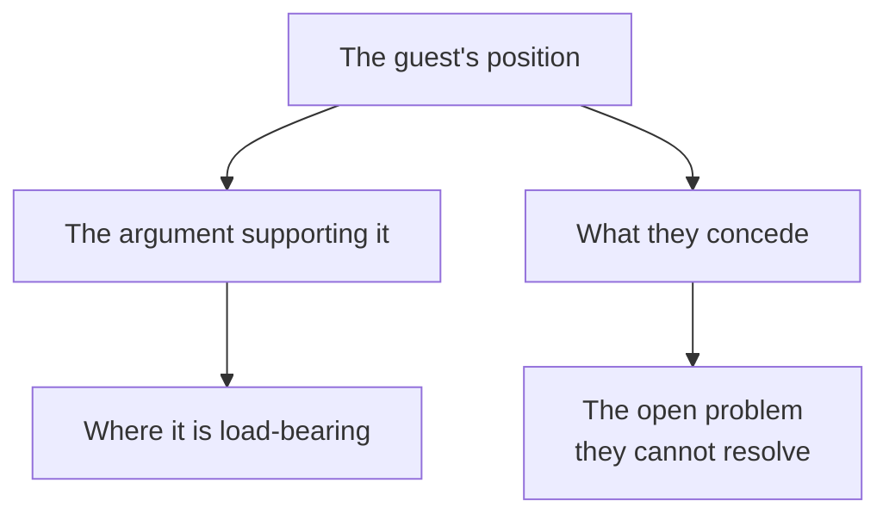

<!-- ILLUSTRATIVE EXAMPLE, annotated.

     Note the status: foreign. This is what a freshly captured note looks like —
     an agent wrote it, nobody has read it, and it appears in READING-QUEUE.md
     until a human does something about it.

     Podcasts are where the vault earns its keep, because long-form audio is where
     people say the things they would not write. A two-hour interview reliably
     contains three or four claims that exist nowhere else, and they are
     unsearchable until someone extracts them. -->

## Core claim

One paragraph stating the central thing the episode establishes — written as a claim you could disagree with, not as a description of what was discussed.

For an interview, the useful version usually isn't the headline topic. It is **the thing the guest conceded, admitted, or revealed that they would not have put in writing.** Lead with that. If the episode's value is one disclosure, say so in the first sentence and build the note around it.

## Key mechanism

Diagram the structure of the argument, not the running order of the conversation. Five to eight nodes. If the episode has no structure worth diagramming, that is a signal the note may not be worth writing.

## 1. [Name the first substantive section]

Transcript-derived sections, one per major idea. For podcasts specifically:

- **Quote exactly, and sparingly.** A direct quote of a concession is worth ten paraphrased ones. Keep quotations short and attributed — notes that transcribe rather than distil are both less useful and a problem if you ever publish them.
- **Attribute precisely.** Who said it, and whether it was a claim, a concession, or a hedge. Misattributing a position to a real person is the most common failure in this kind of note, and it compounds — the error gets cited by later notes.
- **Record refusals.** "Asked about X, they declined and said they weren't across the details" is genuinely informative and almost never captured.

## 2. [The numbers]

Pull every figure into a table. Spoken numbers are the single most valuable and most perishable thing in audio — nobody can grep a podcast.

| Claim | Figure | Stated by |
|---|---|---|
| | | |

## 3. [Where this contradicts something already in the vault]

The section that makes the note compound. If the guest disagrees with another note's source, say so explicitly and name both sides. Cross-source disagreements are the raw material for a thread's **Current tensions**, and they only surface if someone writes them down at capture time.

## Open questions

Three to five, and they must be genuine — the things the episode left unresolved, not comprehension checks.

- Where the guest's argument has a gap they did not address
- Where two of their claims sit awkwardly together
- The measurement that would settle the disagreement, and whether anyone is taking it

## My take

Empty on capture. This is the gate: the note stays `foreign` until a human writes something here, and advancing it without writing is how a vault quietly becomes a pile.

## Connections to existing notes

- [[example-thread-ai-safety]] — which thread this belongs to, and what it contributes
- [[guest-person-note]] — add this episode to their note's chronological list; if they revised a position, record it under **Positions they have publicly revised**
- *A real note carries four to ten of these, each stating what the connection **is**.*

<!-- And the step that does the compounding, from VAULT.md:

     After writing this note, go BACK into the five to ten most related existing
     notes and append a line where this one adds something non-obvious. The new note
     links outward automatically; what Obsidian will not do for you is patch the old
     notes to point forward. Doing that by hand on every pass is what turns a
     collection into a graph. -->
